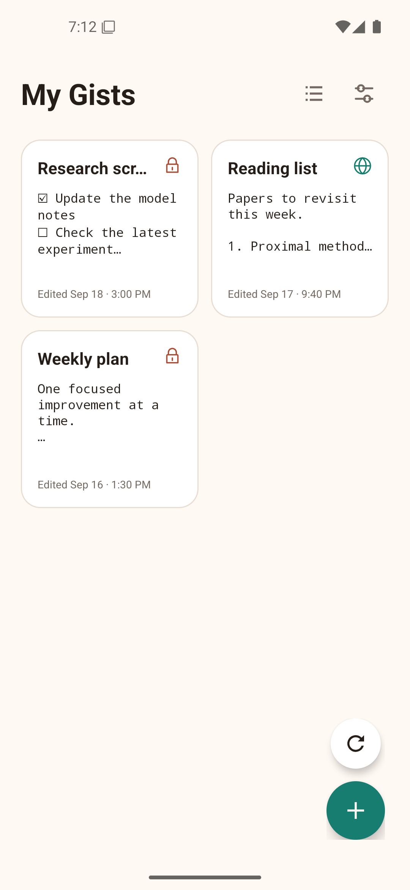
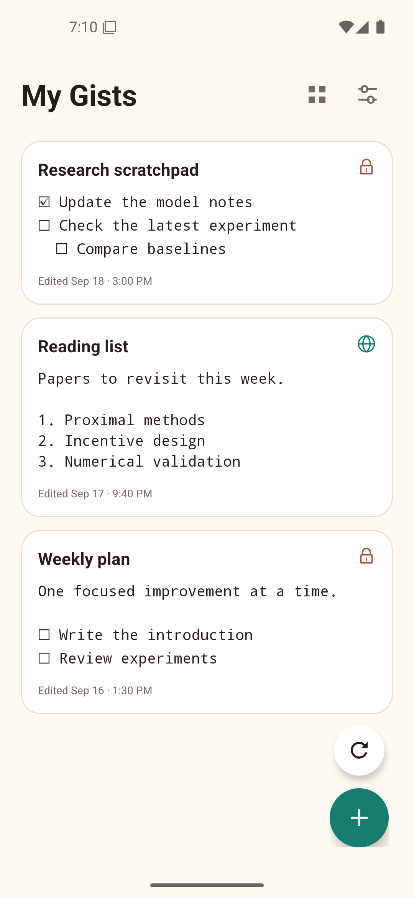
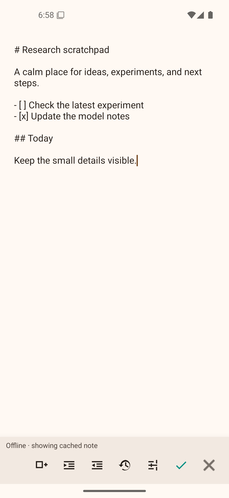
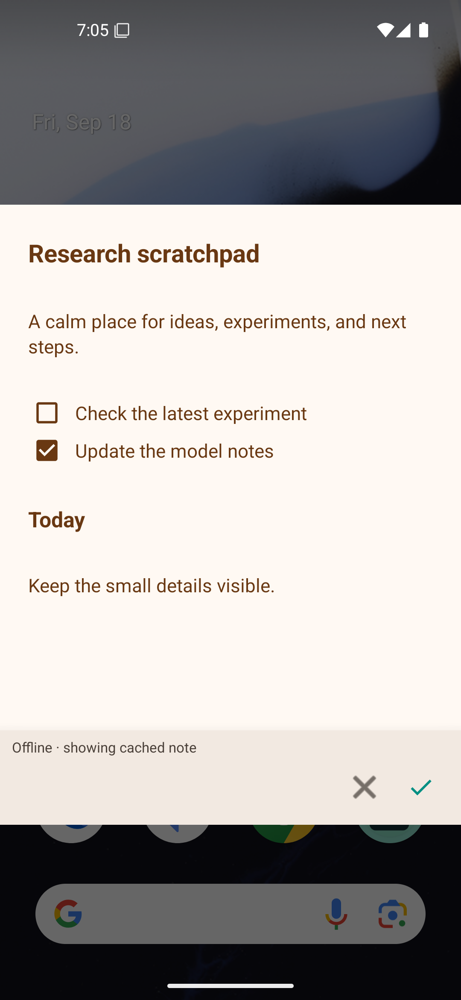
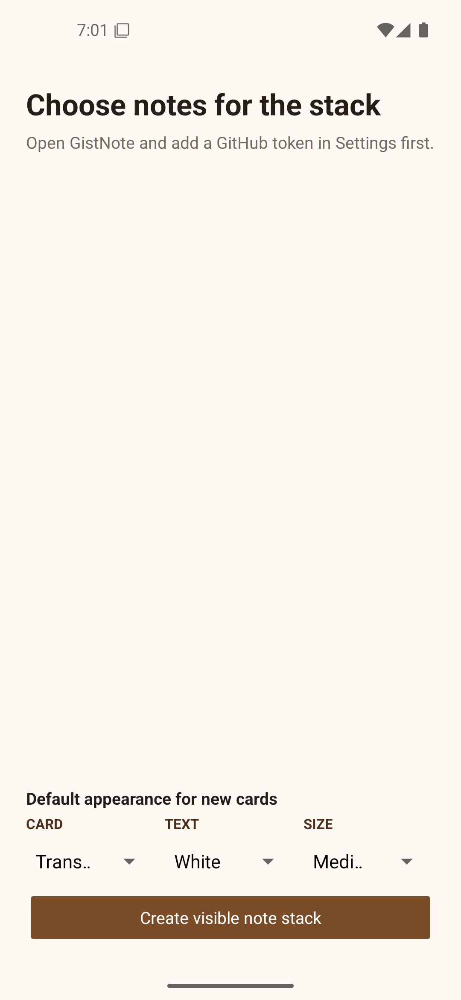
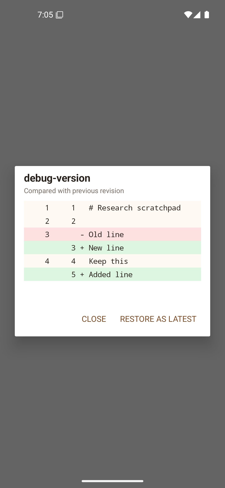

# GistNote

GistNote is a local-first Android note app that uses GitHub Gists as its sync
layer. Write a note on your phone, edit it from anywhere GitHub Gists are
available, and keep Gist's commit history as a record of how the note changed.

It combines a full-screen Markdown editor with editable home-screen widgets:
notes can be displayed individually or grouped into visible stacks, with
per-widget text and background styling.

## Screenshots

| Home — grid | Home — list |
| --- | --- |
|  |  |

| Editor | Widget overlay |
| --- | --- |
|  |  |

| Widget stack | Gist history diff |
| --- | --- |
|  |  |

## Highlights

- Secret Gist creation and explicit, on-demand sync
- Markdown and nested checkbox tasks
- Coloured revision diffs and conflict-aware saves
- Multiple configurable home-screen widgets
- Visible widget stacks with per-note appearance
- No periodic background sync, jobs, alarms, or services

## Documentation

- [Build and development](docs/development.md)
- [GitHub setup, sync, privacy, and implementation notes](docs/architecture.md)

## License

This repository is currently a personal project; no open-source license has yet
been selected.
